# Reinos do Destino — Unity

Migração nativa atualizada para **Unity 6000.6.7f1**, URP 2D, uGUI e TextMeshPro. Abra **esta pasta `Unity/`** no Unity Hub; não abra a raiz do repositório como projeto Unity.

## Iniciar

1. Instale o Editor 6000.6.7f1 pelo Unity Hub e autentique sua conta/licença.
2. Adicione a pasta `Unity/` ao Hub e abra o projeto. Aguarde a resolução de pacotes.
3. Use **Reinos do Destino → Preparar arena mobile** para criar/atualizar a cena principal e as configurações de retrato. Esse comando substitui a cena de arena gerada; salve outras cenas antes de usá-lo.
4. Abra **Reinos do Destino → Abrir arena** e pressione **Play**.

A arena é construída por componentes Unity, sem navegador ou WebView. O bootstrap também permite testar o jogo em uma cena vazia. O Canvas respeita `Screen.safeArea`, usa escala adaptativa e não possui ScrollRect.

## Implementado nesta primeira etapa

- Núcleo de regras C# independente do Unity e da interface.
- Seis criaturas, sete magias, quatro elementos, atributos, escudo e energia.
- Seleção por toque/clique, atacar, defender, jogar, habilidade e turno rival.
- Dano direto/em área, cura, bônus, reduções e bloqueio temporário de ataque.
- Evolução após ações, condições de vitória/derrota, reinício e save local separado do navegador.
- Artes elementais exportadas do protótipo, enquadramento das criaturas e feedback nativo inicial.

## Estrutura

- `Assets/ReinosDoDestino/Core/`: modelo e motor de combate C# puro.
- `Assets/ReinosDoDestino/Runtime/`: arena, interação, UI, save e animação inicial.
- `Assets/ReinosDoDestino/Editor/`: preparação da cena e instalação de pacotes via API oficial.
- `Assets/ReinosDoDestino/Tests/`: testes EditMode e PlayMode do Unity Test Framework.
- `Assets/Resources/Elemental/`: catálogo serializado e artes.
- `Verification/`: runner .NET de paridade com os cenários do protótipo TypeScript.

O projeto parte dos assets/configurações oficiais do template Universal 2D. As dependências foram resolvidas pelo Unity Package Manager para o Editor escolhido: URP 17.6.0, Input System 1.20.1, uGUI 2.6.0 e Test Framework 1.8.0. O pacote Pipeline permite continuar o trabalho pelo Unity CLI.

## Validar as regras sem abrir o Editor

```sh
dotnet run --project Unity/Verification/ReinosDoDestino.Verification.csproj -- Unity
```

Execute esse comando a partir da raiz do repositório com .NET SDK 8. Os cenários de paridade foram produzidos pelo resolvedor TypeScript real. O runner compara vida, ataque, defesa, escudo, bônus, reduções, bloqueio e glória.

```sh
npm ci
node scripts/export-unity-catalog.mjs
node scripts/export-unity-parity.mjs
```

Esses exportadores são ferramentas da migração inicial. Depois da mudança de desenvolvimento para Unity, evite editar o protótipo e reexportar sobre alterações nativas sem revisão.

## Continuar o desenvolvimento

A primeira etapa cobre o combate local. Campanha, relíquias, estatísticas de perfil, som, acessibilidade nativa avançada e efeitos finais equivalentes ao protótipo ainda precisam de port dedicado. Não há compras, anúncios, multiplayer ou backend nesta etapa.

Os saves de `localStorage` não são lidos pelo Unity. O save nativo fica em `Application.persistentDataPath/elemental-unity-v1.json`; saves inválidos são rejeitados. Android e iOS são os alvos de continuidade. Para builds finais, instale os módulos correspondentes no Hub; gerar/assinar iOS requer macOS/Xcode e as credenciais do proprietário.

## Verificação desta migração

- 98 verificações do núcleo C#, incluindo oito cenários comparados ao resolvedor TypeScript.
- Unity Test Framework: seis testes PlayMode aprovados no Editor 6000.6.7f1, incluindo arena 3D, área segura, combate, arrasto e efeitos.
- O teste PlayMode verifica Canvas, entrada, cinco botões dentro da área segura, ataque e avanço do Player Loop. Em modo lote, não faz captura de Game View.

Para repetir os testes, use **Window → General → Test Runner**, abas EditMode e PlayMode. A validação em aparelhos Android/iOS continua necessária antes de distribuir uma versão mobile.

Build Linux nativo gerado e aberto em 540 × 960. A captura abaixo mostra todas as áreas da arena e os cinco controles sem rolagem; o clique em Defender também foi conferido no executável. O ambiente não possui dispositivo de áudio, por isso essa sessão não valida som.

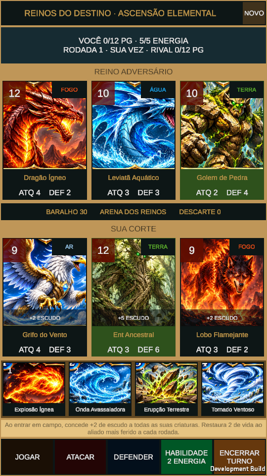

## Jogar no iPhone pelo Safari

Abra https://mariomarques01.github.io/Newcard/unity/ e toque em **INICIAR JOGO**. O primeiro acesso baixa aproximadamente 22 MiB; os arquivos são armazenados em cache para os próximos acessos. No Safari, **Compartilhar → Adicionar à Tela de Início** oferece mais espaço para a arena. A versão React de referência continua no endereço principal.

O template Web respeita a área segura, acompanha a altura disponível do Safari e não usa barras de rolagem. A renderização limita a densidade de pixels a 1,5. O save nativo é sincronizado automaticamente com IndexedDB; fica separado do save do protótipo React.

### Atualizar a versão publicada

1. Instale **Web Build Support** para o Editor 6000.6.7f1 pelo Hub.
2. No Editor, execute **Reinos do Destino → Gerar versão Web**. O resultado fica em `Unity/Builds/WebGL/`. O build usa a cena já salva, sem regenerá-la.
3. Na raiz do repositório, execute:

```sh
node scripts/publish-unity-web.mjs
node scripts/publish-unity-web.mjs --check
```

4. Faça commit das fontes e do resultado em `public/unity/`. O workflow existente publica o conteúdo pelo GitHub Pages após o merge em `main`.

Alternativa em modo lote:

```sh
Unity -batchmode -quit -projectPath /caminho/Newcard/Unity -buildTarget WebGL -executeMethod ReinosDoDestino.Editor.WebBuild.Build -logFile web-build.log
```

O menu **Aplicar configuração Web para iPhone** permite reaplicar os parâmetros: Gzip com descompressão no carregador (Pages não fornece cabeçalhos de compressão personalizados), cache, stripping High, exceções explícitas, memória inicial 128 MiB e máxima 512 MiB. O navegador controla o ritmo de renderização. O build não exige threads ou cabeçalhos de isolamento.

`build-info.json` registra o hash das fontes e de cada arquivo publicado. O deploy rejeita arquivos incompletos ou uma versão WebGL desatualizada em relação ao projeto Unity. Os binários comprimidos são versionados em `public/unity/` para permitir deploy sem instalar o Editor ou disponibilizar credenciais Unity no GitHub Actions.

### Validação do primeiro build Web

Build de 16,9 MiB validado em Chromium e WebKit com entrada por toque em 390 × 700 e 390 × 600: carregamento real do WebAssembly, ausência de rolagem, ataque, defesa, persistência em IndexedDB, retomada após recarregar, troca de turno e magia de fogo (energia, dano e descarte). Nenhum erro JavaScript foi registrado. WebKit em Linux aproxima a execução do Safari; ainda é necessário conferir no iPhone físico do jogador.

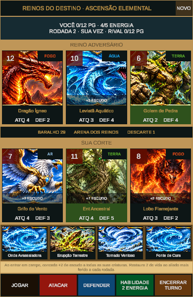

## Arrastar e efeitos elementais

- Arraste uma magia da mão e solte sobre uma criatura do lado indicado: magias ofensivas atingem inimigos; cura e proteção usam aliados. Magias em área aplicam seus efeitos à corte correspondente.
- Arraste uma criatura da sua corte até um inimigo para atacar. As restrições de ataque, bloqueio e energia continuam valendo.
- A prévia acompanha o dedo e destaca os alvos válidos. Soltar fora de um alvo cancela sem consumir carta ou energia. Selecionar e usar os botões continua disponível.
- Ataque, defesa, habilidade e magia possuem carga, projétil quando há deslocamento, impacto, partículas, título e valores flutuantes. Fogo, água, terra e ar têm apresentações distintas; cura, bloqueio, redução de atributos e derrota usam os eventos reais do combate.
- As ações bloqueiam novas entradas por aproximadamente 2,25 s durante a apresentação. O estado completo é salvo no início da ação para não perder a jogada ao sair durante o efeito.
- Os efeitos atuais usam malhas uGUI com formas e movimentos próprios por elemento. O atlas antigo permanece como referência, mas não é o efeito compartilhado das ações. Nenhum efeito intercepta os toques.
- Os arquivos WebGL recebem nomes por hash de conteúdo para evitar mistura de versões em cache.

Testes PlayMode cobrem cancelamento sem gasto, magia no alvo solto, criatura arrastada para atacar, presença e tamanho do efeito visual, bloqueio durante a animação e limpeza ao terminar.

Validação Web deste ajuste: Chromium com gesto de toque via protocolo do navegador e WebKit com eventos de toque DOM; magias dos quatro elementos, cura, habilidade, ataque por arrasto, alvo inválido, energia insuficiente e viewport 390 × 600 sem rolagem. Foram conferidos energia, vida, descarte e bloqueio no estado persistido, sem erros JavaScript.

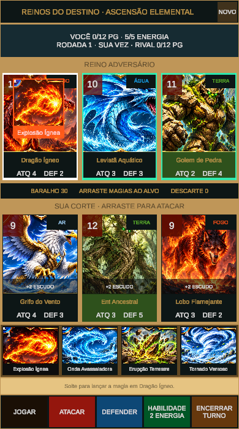
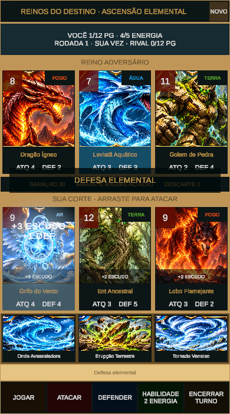
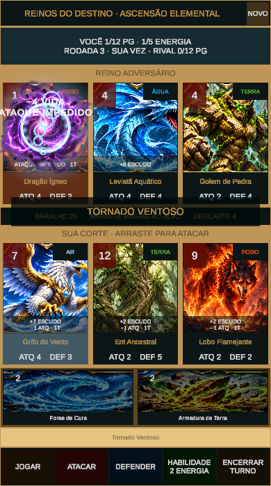

## Reações por elemento e por ação

| Elemento | Origem e trajeto ofensivo | Reação ao impacto | Defesa |
| --- | --- | --- | --- |
| Fogo | Chamas na origem, projétil e cauda flamejante | Chamas sobre o corpo, brasas e fumaça durante alguns segundos | Escudo incandescente com bordas de brasas e crista de fogo |
| Água | Fonte na origem, fitas líquidas e crista de espuma | Jatos, gotas em queda e ondas na base | Bolha azul com reflexos e bolhas menores em movimento |
| Terra | Pedras na origem, blocos em arco com poeira | Espigões de rocha, fissuras verdes e detritos | Contrafortes de pedra nas laterais e muralha na base |
| Ar | Correntes na origem, lâminas e plumas no trajeto | Coluna de vento e redemoinho sobre o alvo | Correntes cruzadas e plumas orbitando a criatura |

As barreiras persistem enquanto a criatura estiver viva, defendendo e com escudo disponível; desaparecem após o fim da guarda ou esgotamento do escudo. As reações visuais de ataque duram um pouco além do bloqueio dos comandos. Chamas, respingos e detritos são apresentação: não acrescentam dano, estados ou bônus ao motor de combate. Cura e evolução usam apresentações de apoio em vez de simular um ataque ao aliado.

Os eventos são separados por ação, origem, alvo e elemento, preservando efeitos distintos quando o turno rival também provoca cura ou evolução. Os valores reais de um mesmo alvo são agrupados para evitar números sobrepostos. Reiniciar limpa os resíduos da apresentação anterior.

`ElementalVfxGraphic` possui `CanvasRenderer` obrigatório e renderiza geometria móvel diretamente com o material padrão da UI. Defesas persistentes atualizam a até 20 fps e reações temporárias a até 30 fps. Cinco testes PlayMode verificam geometria diferente nos oito casos (ataque/defesa × quatro elementos), barreiras de fogo e água, remoção da guarda, arrastar e limpeza de efeitos.

O relógio visual limita saltos de tempo entre quadros para que uma pausa de renderização do navegador não pule a preparação ou o trajeto. Em um aparelho com poucos quadros por segundo, a apresentação pode levar um pouco mais de tempo; os valores do combate e o save permanecem os mesmos.

Capturas da sequência de fogo em uma gravação do navegador (sem montagem de efeitos):

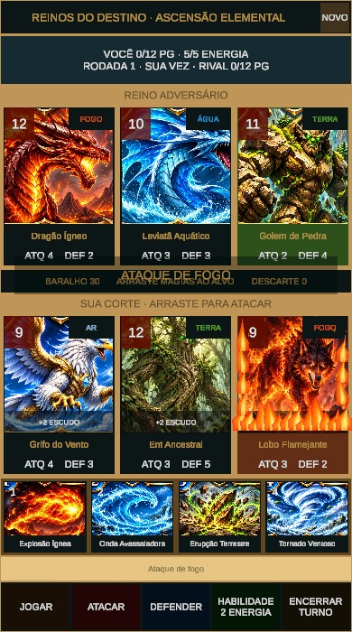
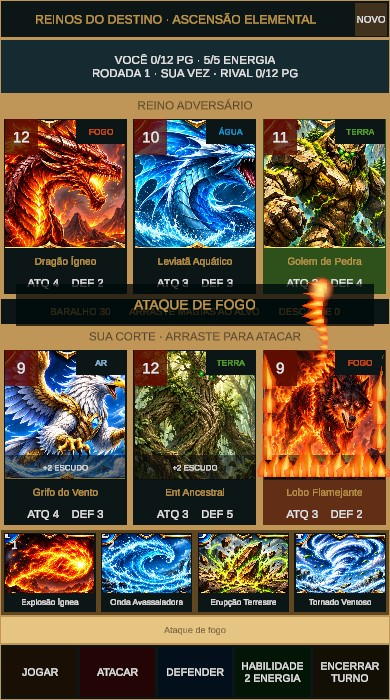
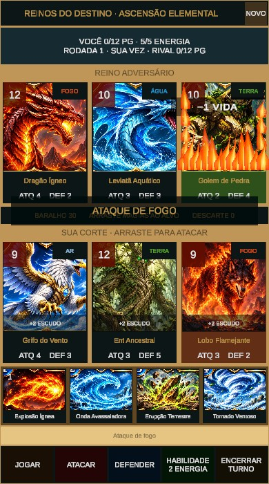

Validação desta versão: cinco testes PlayMode aprovados no Unity; execução em Chromium e WebKit (inclusive densidade de tela 3, limitada internamente pelo template a 1,5), com ataques e magias dos quatro elementos e as quatro defesas. Vida, energia e escudo foram conferidos no IndexedDB; viewport 390 × 600 sem rolagem e nenhum erro JavaScript nos testes. A gravação quadro a quadro confirmou a origem, o trajeto e a reação de fogo no build WebGL.

Defesas persistentes do build final no Chromium:

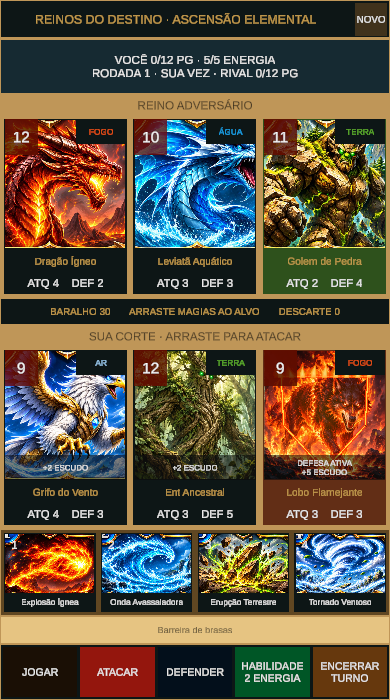
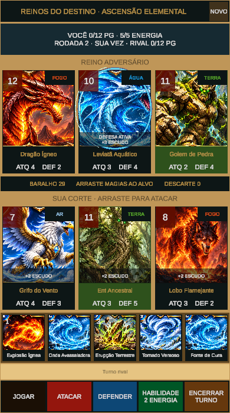
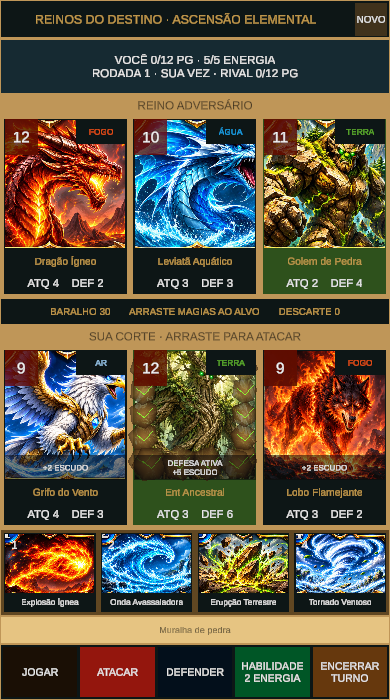
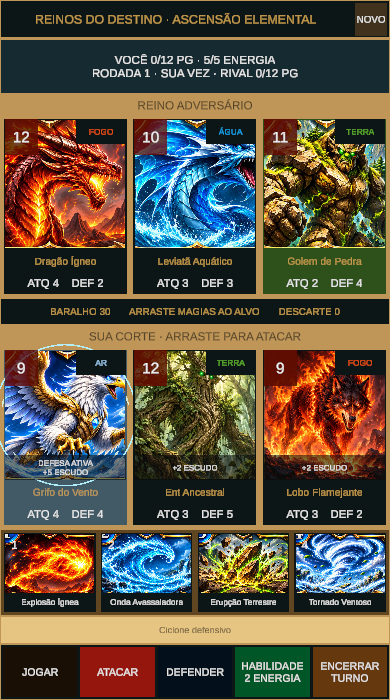
